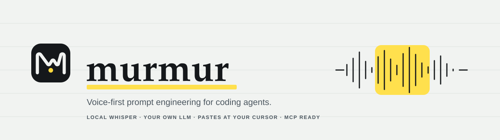
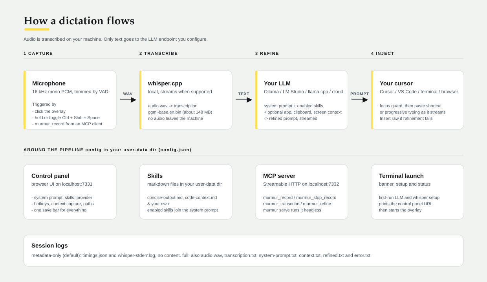

<p align="center">
  <picture>
    <source media="(prefers-color-scheme: dark)" srcset="docs/banner-dark.svg"/>
    
  </picture>
</p>

<p align="center">
  <a href="https://www.npmjs.com/package/@mouadja02/murmur"></a>
  <a href="https://www.npmjs.com/package/@mouadja02/murmur"></a>
  <a href="https://github.com/mouadja02/murmur/actions/workflows/ci.yml"></a>
  <a href="https://github.com/mouadja02/murmur/releases"></a>
  
  
  
</p>

---

## What is Murmur?

Talk to your coding agent the way you'd explain it to a colleague. Murmur turns the rambling into a prompt, **without adding anything you didn't say**.

It is a tiny floating button on top of your desktop. You tap it (or hold a hotkey) and talk, and a few seconds later a clean prompt appears exactly where your cursor is: in Cursor, Claude Code, Copilot, ChatGPT, a terminal, a GitHub issue.

Your voice is transcribed **on your own machine** with `whisper.cpp`, then rewritten by **your own LLM** (Ollama, LM Studio, a llama.cpp server, or a cloud endpoint if you choose one). Audio never leaves your computer. Only the text goes to the LLM endpoint you configured, and by default that is local. Coding agents can also call Murmur themselves: see [MCP server mode](#option-d--mcp-server-mode-headless-no-overlay).

### What refinement does to a dictation

The default system prompt is written for fidelity. It removes fillers and dictation artifacts, keeps identifiers, negations and uncertainty as you said them, and is told not to invent requirements, constraints or output formats ([`src/main/config/defaults.ts`](src/main/config/defaults.ts)).

> **Placeholder: a real before → after pair goes here.** It has to be a capture, not an invented example (tracked in [#45](https://github.com/mouadja02/murmur/issues/45)). To make one: set **Paths → Session logging** to `full`, dictate a realistic prompt, then copy `transcription.txt` (before) and `refined.txt` (after) from the newest folder under your logs directory.
>
> | | |
> | --- | --- |
> | **Spoken** | _…the raw transcription…_ |
> | **Inserted** | _…the refined prompt…_ |

### Is it worth the setup?

Setup is a one-time cost: Node 20+, a local LLM (the default `qwen3:4b` is a multi-gigabyte pull), `whisper.cpp` (built from source on Linux and macOS, a prebuilt binary on Windows) and a ~148 MB model. Most of it is downloads, so the time depends on your connection. After that a dictation is: hold, talk, release. How long the refinement takes depends on your model and hardware; `timings.json` in each session folder records the real numbers on your machine.

If you only need plain speech-to-text, your operating system's built-in dictation is simpler. Murmur is for the case where you talk to coding agents all day and want the prompt cleaned up without it being embellished.

---

## See it in 30 seconds

1. **A small pill floats on your desktop.** Always on top. Drag it anywhere.
2. **Click it (or hold `Ctrl+Shift+Space`) and talk.** A soundbar reacts while you speak.
3. **Release.** The pill walks through *recording → transcribing → refining → injecting → done*.
4. **The refined prompt appears at your cursor.** Murmur copies it to your clipboard, auto-pastes it with the platform paste shortcut, and leaves it there so you can paste again manually.

You stay in flow. No context switch. No "open app, paste, reformat, paste again."

---

## Get started

You need **Node.js 20+**, a working microphone, and a local LLM server running somewhere (see the table further down if you're not sure which). Windows 10/11, macOS 12+, and modern Linux (X11; Wayland via Xwayland) are supported. CI builds and tests on Windows and Ubuntu, so macOS and Wayland get less testing; see [Known limitations](#known-limitations).

### Option A — just try it (no clone)

```bash
npx @mouadja02/murmur
```

That pulls the published package from npm, runs the pre-launch banner, and spins up the overlay. Getting to your first dictation also takes the one-time setup below.

**On the first run, Murmur detects your OS and walks you through setup interactively.** It first asks for your LLM connection:

```
── LLM setup ─────────────────────────────────────────────

    ? LLM_PROVIDER (ollama | openai-compat | anthropic)
    ? LLM_BASE_URL (suggested: http://localhost:11434)
    ? LLM_MODEL (example: qwen3:4b)
```

If `LLM_PROVIDER`, `LLM_BASE_URL`, or `LLM_MODEL` already exist in your environment or `.env`, Murmur shows them as defaults. Press Enter to keep using the env value without writing over it in `config.json`. If no env value exists, Murmur requires an explicit answer so you do not accidentally launch against the wrong model.

If `whisper-cli` and/or the model file are missing, it asks:

```
── First-time setup ────────────────────────────────────────

  o whisper-cli not found at /home/you/.config/murmur/whisper-cli
    ? Install whisper.cpp now? (builds from source, ~2-5 min) (Y/n)

  o whisper model not found at /home/you/.config/murmur/models/ggml-base.en.bin
    ? Download ggml-base.en.bin (~148 MB)? (Y/n)
```

Say yes and Murmur does the rest — building `whisper.cpp` from source on Linux/macOS (or downloading a prebuilt binary on Windows), downloading the model, and writing the correct paths into your config file. No manual setup script, no editing JSON.

If you prefer to run the setup step manually (e.g. on a CI agent):

```bash
# Windows: downloads whisper-cli.exe + ggml-base.en.bin into <userData>/bin/whisper/
npx @mouadja02/murmur setup:whisper

# macOS / Linux: downloads ggml-base.en.bin into ./models/
# and prints the exact command to install whisper-cli via your package manager
npx @mouadja02/murmur setup:whisper
```

### Option B — install globally

```bash
npm install -g @mouadja02/murmur
murmur
```

After this, `murmur` is on your `PATH` and you can launch it from any terminal.

### Option C — hack on the source

```bash
git clone https://github.com/mouadja02/murmur.git
cd murmur
pnpm install
pnpm setup:whisper
pnpm dev
```

Options A-C drop you in the same overlay flow. The first run creates a config file at `%APPDATA%\murmur\config.json` (Windows), `~/Library/Application Support/murmur/config.json` (macOS), or `~/.config/murmur/config.json` (Linux), pre-filled with just the absolute whisper, logs and skills paths (every other setting uses its built-in default until you change it), and prints a banner in the terminal. Grab the **control panel URL** it shows (default `http://localhost:7331`) to tweak things in a browser without touching JSON.

### Option D — MCP server mode (headless, no overlay)

Run Murmur as a local MCP server for Cursor, Claude Code, VS Code Copilot, or any Streamable HTTP MCP client:

```bash
murmur serve --port 7331 --mcp-port 7332
```

| Service | URL |
| --- | --- |
| Control panel | `http://127.0.0.1:7331` |
| MCP (Streamable HTTP) | `http://127.0.0.1:7332/mcp` |

**Headless recording** uses a local command, not the Electron overlay mic:

- **Windows / macOS:** [SoX](http://sox.sourceforge.net/) (`sox` on `PATH`)
- **Linux:** ALSA utils (`arecord` on `PATH`)

Override with `--recorder-command` or `MURMUR_RECORDER_COMMAND` if needed.

If startup fails with `headless recorder command not found: sox`, install SoX and restart your terminal:

```powershell
winget install --id ChrisBagwell.SoX -e
sox --version
```

If `sox --version` still fails, add the SoX install folder to `PATH` or pass the full executable path with `--recorder-command`.

If `winget` says SoX is already installed but `sox --version` still fails, the portable install may be incomplete or not linked into `PATH`. Remove and reinstall it, then verify again:

```powershell
winget uninstall --id ChrisBagwell.SoX -e
winget install --id ChrisBagwell.SoX -e
sox --version
```

**Integration guides:**

- [Cursor](docs/integrations/cursor.md) — `.cursor/mcp.json`
- [Claude Code](docs/integrations/claude-code.md) — `.mcp.json` / `claude mcp add`
- [VS Code Copilot](docs/integrations/vscode-copilot.md) — `.vscode/mcp.json`
- [Shell / generic MCP clients](docs/integrations/shell.md) — endpoint, tools, MCP Inspector

> **Linux runtime deps.** The overlay's global hotkeys + paste injection use `uiohook-napi` + `@nut-tree-fork/nut-js`, which link against X11 at runtime. On Ubuntu/Debian:
>
> ```bash
> sudo apt-get install -y libx11-6 libxtst6 libxkbcommon0
> ```
>
> Most desktops ship these by default; install them if the overlay fails to boot with an `Error loading shared library` message.

> **macOS accessibility permission.** Synthetic key events (the `Cmd+V` paste step) require Murmur to be granted **Accessibility** access. On first run, macOS will prompt you automatically. If you dismissed the prompt, go to **System Settings → Privacy & Security → Accessibility**, find `Electron` (or `Murmur`), and toggle it on. Without this permission the overlay runs but the refined text will not be pasted at your cursor.

> If you don't have a local LLM yet, the fastest path is:
> ```powershell
> # Install Ollama from https://ollama.com, then:
> ollama pull qwen3:4b
> ```
> Murmur targets `qwen3:4b` on Ollama by default.

---

## How it works

<p align="center">
  <picture>
    <source media="(prefers-color-scheme: dark)" srcset="docs/architecture-dark.svg"/>
    
  </picture>
</p>

Four stages. Audio is transcribed on your machine; only text goes to the LLM endpoint you configured.

| Stage | What happens |
| --- | --- |
| **Capture** | The overlay records 16 kHz mono PCM while you hold the hotkey (or, in toggle mode, between two presses of it), or between two clicks. Voice activity detection trims leading silence, ends a click-to-record capture after a pause, and drops captures with no speech. |
| **Transcribe** | `whisper.cpp` turns the WAV into text on your CPU, streaming partial results when your build supports it. |
| **Refine** | Your LLM rewrites the transcription into a concise prompt using your active system prompt + enabled skills (+ the optional context you opted into). Tokens stream from the provider, which is what makes progressive injection possible. |
| **Inject** | Murmur copies the refined text, fires `Ctrl+V` (Windows/Linux) or `Cmd+V` (macOS) at your current cursor, and keeps the generated prompt on your clipboard by default. With **Progressive injection** it types the tokens as they arrive instead. |

Click or hotkey again while a dictation is still being processed and the next one is queued (up to `queueMaxDepth`, default 3). With `prewarm` on (the default) Murmur asks the provider to load the model at startup so the first dictation is less likely to hit a cold start. A model that sits idle longer than the provider's keep-alive can still cold-start.

**When a step fails after your words were transcribed**, the error toast offers **Retry** and **Insert raw**, which inserts exactly what you said, with no provider call. If inserting fails too, the text goes to the clipboard instead. The right-click menu has the same **Insert raw transcription** item. A failed `murmur_record` MCP call returns the transcription in `structuredContent` as well.

**If you switch windows while a dictation is being processed**, Murmur does not paste into the new one. It remembers which window was in front when the capture started, and if a different one is in front when the prompt is ready (or before the first character is typed, with progressive injection) it copies the prompt to the clipboard and tells you to paste it where you want it. Set `focusChangePolicy` to `paste` to keep the old behaviour of inserting into whatever is in front. Windows are compared by their native handle, never logged, and if the operating system cannot tell windows apart (some Wayland sessions) or the overlay itself had focus when you started, Murmur inserts as before. The check covers captures started from the overlay or hotkey and `murmur_record` with `inject: true`; **Retry**, **Refine last** and **Insert raw** are actions you take at that moment, so they insert into whatever is in front. Progressive injection checks once, before the first keystroke, and does not stop typing if you switch windows part-way through.

**Progressive injection** (typing as tokens stream) stops at the first chunk it cannot type instead of skipping it, so a prompt never loses words from its middle. The dictation is then reported as an error, and the full prompt is copied to the clipboard. If part of a dictation is already in the target (typing stopped, or the stream failed mid-way), **Retry**, **Refine last** and **Insert raw** copy to the clipboard rather than typing over it. The toast says so; clear the partial text and paste.

Every session gets a timestamped folder in your logs directory. By default (`metadata-only`) it holds only `timings.json` and `whisper-stderr.log`: no audio, no text and no error messages, so the toast and the terminal are where an error shows up. Set **Paths → Session logging** to `full` if you want audio, the raw transcription, system prompt, context and refined output (and error details) persisted locally. See [Session logs](#session-logs).

---

## Features at a glance

- **One-click or push-to-talk** — click the pill, or hold `Ctrl+Shift+Space`. Prefer not to hold keys? Set **Push-to-talk mode** to *Toggle* (`hotkeyMode`): press once to start, again to stop.
- **Drag anywhere** — pill position is saved and survives restart.
- **Toggle hotkey** — `Ctrl+Shift+H` hides / shows the overlay from any app.
- **Right-click menu** — refine the last transcription, insert the raw transcription after a failure, open the control panel, reset position, quit.
- **Control panel on localhost** — browser-based UI for system prompt, skills, provider, hotkeys, and paths. Changes hot-reload without restarting, and a value the config rejects (for example a base URL without `http://`) is refused with a message next to the field instead of being reported as saved.
- **Skills as Markdown** — drop `.md` files into your skills folder (**Paths** shows where it is), toggle them on/off from the panel. Import directly from a local file or a raw URL. Version-controllable, shareable.
- **Opt-in context** — share the active app and window title, recent clipboard entries or a screenshot with the model, and switch skills per app. Everything is off by default; see [Voice & context](#voice--context).
- **Voice activity detection** — trims leading silence, ends click-to-record after a pause and drops captures with no speech.
- **Queue and recover** — dictate again while one is processing and it queues. If a step fails after your words were transcribed, **Retry** or **Insert raw**; **Refine last** re-runs the last transcription with the current prompt and skills.
- **Focus guard** — if you switch windows mid-dictation, the prompt is copied instead of pasted into the wrong one.
- **Tray icon** — shows idle, recording, processing and error state, with show, hide, panel and quit.
- **CLI / env override badges** — when a field's value comes from a `--flag` or env var, the control panel marks it read-only with a clear badge and tooltip explaining exactly how to unlock it. If an env var is set but a flag or `config.json` outranks it, the field stays editable and a note says why the env var has no effect.
- **Terminal pre-launch banner** — every `pnpm dev` shows your current setup and offers a one-key menu to edit the prompt or jump to the panel.
- **Provider agnostic** — Ollama native API, any OpenAI-compatible server (LM Studio, llama.cpp server, vLLM, Jan, KoboldCpp, oobabooga, …), and Anthropic Claude.
- **Local by default** — no telemetry. While running, the only outbound call is to the LLM endpoint you configured (plus a skill import from a URL you paste). Setup downloads `whisper.cpp` and its model once.
- **Session logs** — every run writes a folder with `timings.json` (and, in `full` mode, audio, transcription, prompts and refined text) for traceability.
- **MCP server mode** — `murmur serve` exposes Streamable HTTP tools (`murmur_record`, `murmur_stop_record`, `murmur_transcribe`, `murmur_refine`) for IDE agents without launching Electron. The overlay app serves the same MCP endpoint on `mcpPort`.

---

## The control panel

Open it from the overlay (right-click → **Open control panel**), from the pre-launch terminal menu, or by pasting `http://localhost:7331` into your browser.

The sidebar groups the sections: **Prompt** (System prompt, Skills), **Models** (Provider, Whisper), **Capture** (Hotkeys, Voice & context), **System** (Paths) and **Help** (Model guide). The panel follows your OS light or dark setting.

| Section | What you can do |
| --- | --- |
| **System prompt** | Live-edit the active prompt and see the composed preview (base + enabled skills). |
| **Skills** | Add, edit, rename, delete skills. Import from a local `.md` file or any raw Markdown URL (GitHub raw, Gist, …). One switch to enable/disable each. |
| **Provider** | Switch provider, base URL, model, API key, temperature. A **Local / Cloud / Network** badge beside the heading says where your data goes, and follows the base URL as you type. One-click presets for local and online providers. **Test connection** reports latency for the *saved* settings, and says so if you have unsaved provider edits. Fields whose value comes from a CLI flag or env var are shown read-only with a lock badge — see [Config precedence](#config-precedence). |
| **Whisper** | Point to a different `whisper-cli` binary (or `whisper-cli.exe` on Windows) or `.bin` model. |
| **Hotkeys** | Bind push-to-talk and toggle combos by pressing **Record** and then the keys (a bare letter is refused, so normal typing is never hijacked), choose hold or toggle push-to-talk, choose insertion mode, decide what happens if the active window changed before insertion, and whether the generated prompt stays on the clipboard after auto-paste. |
| **Voice & context** | Voice activity detection with sliders for the speech threshold, silence timeout and lead-in, and the switches for what context the model sees. |
| **Paths** | Logs dir, skills dir, and the resolved config file path. |
| **Model guide** | Hardware-tiered model recommendations with one-click `ollama pull` copy commands. |

**One save bar.** Edits are not written as you type. A bar at the bottom shows which sections have unsaved changes (they are also dotted in the sidebar) with **Discard** and **Save changes** (`Ctrl+S`); the browser warns before you leave with unsaved edits. A save writes every changed section together, back to the config file atomically, and hot-reloads in the running app — no restart needed. If the config refuses a value, the field is marked and the section stays unsaved.

> **Auto-refresh and form protection.** The panel polls `/api/state` every 4 seconds to keep the composed system prompt and skill list in sync. It will never overwrite a field you are actively editing — each form section tracks its own "dirty" state and auto-refresh skips it until you save or discard.

---

## Skills

Skills are small Markdown files that layer onto your base system prompt when enabled. Perfect for *"always talk like a senior Go reviewer"*, *"bias toward concise output"*, or project-specific vocabulary.

Each skill is a file named `<id>.md` in your skills folder:

```markdown
---
id: concise-output
name: Concise output
description: Trim filler, keep the prompt to the point.
---

Prefer terse, structured prompts. Use bullets for constraints.
No hedging, no apologies, no restating the question.
```

You can author them in your editor (they're git-friendly) or in the control panel's **Skills** tab. Enabled skills are concatenated under an `## Active skills` header in the prompt sent to the LLM.

A skill is identified by its frontmatter `id` (the filename is used only when the file has none), and the panel edits and deletes the file the skill was loaded from, so a hand-dropped `team-notes.md` with `id: team-vocab` behaves like any other skill. Creating a skill never overwrites an existing one: if the ID is taken the panel asks whether to replace it, and if a file name is taken by another skill you pick a different ID. If two files declare the same `id`, the one named `<id>.md` is used (otherwise the first by filename) and the panel lists the ignored file.

The two example skills (`concise-output`, `code-context`) are added once to a new skills folder. Delete them and they stay deleted; remove the `.seeded-skills` marker file in that folder to get them back.

### Importing skills

The **Skills** tab has an **↑ Import** button that opens an import panel with two tabs:

- **From file** — click to browse or drag-and-drop any `.md` file onto the drop zone. Parses YAML frontmatter (`id`, `name`, `description`) and body, then pre-fills the new-skill form.
- **From URL** — paste any raw Markdown URL (e.g. a GitHub raw link or Gist) and click **Fetch**. Works with any public `.md` file.

Both paths land in the new-skill form where you can review and adjust before saving.

---

## Voice & context

Both live in the control panel's **Voice & context** section. Voice settings only shape the recording; context settings decide what *else* the model sees besides your words.

### Voice activity detection

On by default (`vadEnabled`). It trims silence before you start speaking (`vadLeadInMs`, 300 ms of lead-in is kept), drops a capture that contains no speech, and ends a **click-to-record** capture after a pause (`vadSilenceMs`, 1500 ms). Speech is anything louder than `vadThresholdDb` (-40 dBFS; try -50 for a quiet microphone). A hotkey in **toggle** mode never auto-stops on a pause: you press again to stop.

### Context sent to the model

Everything here is **opt-in and off by default**. Context is captured **when the recording starts**, not when it ends, and it is sent to your configured LLM provider together with the transcription. With a local provider it stays on your machine; with a hosted provider window titles, clipboard text and screenshots leave it. The control panel's **Local / Cloud / Network** badge tells you which case you are in.

| Setting | What is captured | Notes |
| --- | --- | --- |
| `contextCapture` | The active app's process name, its window title and the OS | Read from the OS at the start of each capture; your OS may ask for a permission the first time. |
| `clipboardContextEntries` | The last N things you copied (0 to 5; 0 turns it off and clears what was collected) | Each entry is cut to 500 characters. Entries older than 5 minutes are not shared, and entries a password manager marks as concealed are skipped. Text Murmur pasted itself is not fed back. |
| `screenshotContext` | A screenshot of the primary screen (JPEG, at most 1920×1080) | Only useful with a vision-capable model; your OS may ask for screen-recording permission. |

**Refine last** and **Retry** resend only what these settings allow *now*, and nothing if you switched provider since the capture.

`appSkillRoutes` turns skills on or off for particular apps. It is a list in `config.json` (and a JSON box in the panel); `match` is a case-insensitive part of the app name or window title:

```json
"appSkillRoutes": [
  { "match": "code", "enable": ["code-context"], "disable": [] }
]
```

In `full` log mode the composed context block is written to `context.txt` in the session folder.

---

## LLM providers

Pick one. The `openai-compat` provider covers practically every local server that speaks the OpenAI chat-completions dialect — and also cloud endpoints like OpenAI and OpenRouter.

| Provider | `--provider` | Default base URL | Known-good servers |
| --- | --- | --- | --- |
| **Ollama (native)** | `ollama` | `http://localhost:11434` | Ollama. Uses `/api/generate` with `think:false`. |
| **OpenAI-compatible** | `openai-compat` | `http://localhost:1234/v1` | LM Studio, llama.cpp server, vLLM, Jan, KoboldCpp, oobabooga, Ollama's own `/v1` endpoint — **and** OpenAI, OpenRouter, Groq (online). |
| **Anthropic (Claude)** | `anthropic` | `https://api.anthropic.com/v1` | Claude 3 Haiku, Sonnet, Opus. Requires an API key. ☁ Online. |

> `openai-compat` expects the **full** base URL including `/v1` — Murmur will not append it for you.

> `anthropic` also expects `/v1` in the base URL (`https://api.anthropic.com/v1`).

> ⚠️ **Online provider data notice.** When `baseUrl` points to a hostname (not `localhost` or an IP address), the control panel shows a warning banner after you save. Cloud providers receive your voice transcription text and refined prompts. Review each provider's privacy and data-retention policy before use. **We recommend a local model** for any sensitive or proprietary work — see the [Model guide](#model-guide) below.

### Quick recipes

```powershell
# Ollama (default)
ollama pull qwen3:4b
pnpm dev

# LM Studio — load a model, click "Start Server"
pnpm dev --provider openai-compat --base-url http://localhost:1234/v1 --model qwen/qwen3-1.7b

# llama.cpp server
# llama-server -m models/qwen3-4b.Q4_K_M.gguf --port 8080
pnpm dev --provider openai-compat --base-url http://localhost:8080/v1 --model qwen3

# Generic, with an API key
pnpm dev --provider openai-compat --base-url http://localhost:5000/v1 --model my-model --api-key sk-xxx

# OpenAI (online ☁)
pnpm dev --provider openai-compat --base-url https://api.openai.com/v1 --model gpt-4o-mini --api-key sk-...

# Anthropic Claude (online ☁)
pnpm dev --provider anthropic --base-url https://api.anthropic.com/v1 --model claude-haiku-4-5 --api-key sk-ant-...

# OpenRouter (online ☁ — free models available)
pnpm dev --provider openai-compat --base-url https://openrouter.ai/api/v1 --model meta-llama/llama-3.1-8b-instruct:free --api-key sk-or-...

# Groq (online ☁ — very fast inference)
pnpm dev --provider openai-compat --base-url https://api.groq.com/openai/v1 --model llama-3.1-8b-instant --api-key gsk_...
```

---

## Overlay cheatsheet

| Action | Behaviour |
| --- | --- |
| **Click** the pill | Toggles recording (start / stop) |
| **Hold** `Ctrl+Shift+Space` | Push-to-talk: records while held, processes on release |
| **Press** `Ctrl+Shift+Space` (`hotkeyMode: "toggle"`) | Starts recording; the next press stops it. A pause in your speech does not stop it, unlike click-to-record. Pressing while a dictation is still processing queues the next one, like clicking the pill |
| **Tap** `Ctrl+Shift+H` | Show / hide the overlay from anywhere |
| **Drag** the pill | Moves it; the new position survives restart |
| **Right-click** the pill | Context menu: refine last · insert raw transcription · open control panel · hide · reset position · quit |
| **Hover** the pill | Tooltip with provider · model · both hotkeys · hints |

### From the terminal

After Murmur finishes bootstrapping it prints a compact status block in the terminal with **clickable links** (thanks to OSC-8 hyperlinks — works in Windows Terminal, iTerm2, VS Code, Alacritty, WezTerm, Kitty and most modern emulators):

```
  o murmur is ready
    Overlay   show / hide / toggle
    Panel     http://localhost:7331
    Hotkeys   Ctrl+Shift+Space (push-to-talk) / Ctrl+Shift+H (toggle)
```

- **Overlay links** use Murmur's custom `murmur://show`, `murmur://hide`, `murmur://toggle` URL scheme. Clicking them (Ctrl-click in some terminals) routes the action straight into the already-running Murmur instance via Electron's single-instance lock — **no browser tab opens**. Registration happens automatically the first time Murmur starts; on Linux a `.desktop` file is written to `~/.local/share/applications/`.
- **Panel link** is a regular `http://` URL and opens the control panel in your default browser.

The same overlay controls live in the **Overlay** widget at the top-right of the browser panel, with a live status pill (visible / hidden).

---

## Config precedence

Settings are resolved in this order, highest to lowest:

```
CLI flags  >  config file  >  environment variables  >  built-in defaults
```

A key written in `config.json` therefore beats the same setting's env var, and a `--model` flag beats both. On first run Murmur only pre-fills the absolute whisper, logs and skills paths (skipping any whose env var is set at that moment), so env vars such as `MURMUR_HOTKEY` or `MURMUR_RECORDER_COMMAND` take effect until the matching key appears in `config.json`. Saving a field from the control panel writes it to `config.json`, which from then on outranks the env var.

**The control panel reflects the order that is actually in effect.** Any field whose current value comes from a CLI flag or env var is rendered read-only with a coloured badge beneath it:

```
Locked by --model CLI flag
```

Hovering the badge shows a tooltip: *"Restart Murmur without the --model flag to edit this here."*

If an env var is set but a higher-precedence source wins, the field is **not** locked. A note under it says so (for example *"MURMUR_HOTKEY is set, but config.json overrides it"*), and Murmur prints the same warning at startup. To make the env var take effect, remove that key from `config.json`. Configs created by Murmur 0.7 or earlier already contain every key, so their env vars stay shadowed until you do.

To unlock a locked field: remove the corresponding entry from your `.env` file or drop the flag from the `pnpm dev` command.

---

## Session logs

Every dictation writes a timestamped folder inside your logs directory (**Paths** shows where; `logsDir`). Folders are never cleaned up automatically, so delete old ones yourself if the directory grows. The default `logMode` is `metadata-only`, which does **not** persist audio, transcripts, prompts, context or error messages:

```
<logsDir>/2026-04-17T19-28-01-234Z/
├── whisper-stderr.log
└── timings.json          # audioDurationMs, transcribeMs, refineMs, injectMs, totalMs
```

If you switch **Paths → Session logging** to `full`, Murmur also persists the content artifacts for local debugging:

```
<logsDir>/2026-04-17T19-28-01-234Z/
├── audio.wav             # exactly what Whisper received
├── transcription.txt     # Whisper's raw output
├── system-prompt.txt     # base + enabled skills, as sent
├── context.txt           # the context block, if you enabled any context
├── refined.txt           # what got pasted
├── error.txt             # message and stack, only when something failed
├── whisper-stderr.log
└── timings.json          # audioDurationMs, transcribeMs, refineMs, injectMs, totalMs
```

`timings.json` is your ground truth for latency on your own hardware: compare `transcribeMs` and `refineMs` across a few dictations, and compare the first one after startup with later ones to see cold-start cost. Full logs may contain sensitive speech and prompt data; keep `metadata-only` for privacy-sensitive work.

---

## Power-user reference

<details>
<summary><strong>CLI flags</strong></summary>

CLI flags trump both the config file and environment variables. Append them after `pnpm dev`:

```powershell
pnpm dev --provider openai-compat --base-url http://localhost:1234/v1 --model qwen/qwen3-1.7b
```

| Flag | Purpose |
| --- | --- |
| `--provider <ollama \| openai-compat \| anthropic>` | Provider implementation |
| `--base-url <url>` | Provider HTTP base URL |
| `--model <id>` | Model identifier on the provider |
| `--api-key <key>` | Bearer token (required for Anthropic; optional for `openai-compat`) |
| `--temperature <float>` | Sampling temperature (default `0.2`) |
| `--whisper-cli <path>` | Path or `PATH`-resolvable name of `whisper-cli` (`whisper-cli.exe` on Windows) |
| `--whisper-model <path>` | Path to a `ggml-*.bin` model file |
| `--hotkey <combo>` | Push-to-talk combo (default `Ctrl+Shift+Space`) |
| `--hotkey-mode <hold\|toggle>` | Push-to-talk by holding the combo (default), or press once to start and again to stop |
| `--toggle-hotkey <combo>` | Show/hide combo (default `Ctrl+Shift+H`) |
| `--focus-change-policy <copy\|paste>` | If the active window changed since the capture started: copy the prompt and notify (default), or paste anyway |
| `--injection-method <auto\|clipboard\|type>` | Insert by paste, type directly, or paste with typing fallback |
| `--progressive-injection` | Type tokens into the cursor as they stream (needs the `type` or `auto` method) |
| `--clipboard-retention <keep-generated\|restore-previous>` | Keep the generated prompt on the clipboard after paste, or restore the previous clipboard |
| `--clipboard-restore-delay <ms>` | How long to wait before the clipboard is restored after a paste (default `150`) |
| `--vad <true\|false>` | Voice activity detection (default `true`) |
| `--vad-threshold <db>` / `--vad-silence <ms>` / `--vad-lead-in <ms>` | Speech threshold (default `-40`), pause that ends a click-to-record capture (`1500`), audio kept before speech (`300`) |
| `--context` | Share the active app and window title with the model |
| `--clipboard-entries <n>` | Share the last N clipboard entries (0 to 5, default `0`) |
| `--screenshot` | Attach a screenshot (vision-capable models only) |
| `--logs-dir <path>` | Per-session logs directory |
| `--log-mode <metadata-only\|full>` | Persist timings/errors only, or full local debugging artifacts |
| `--skills-dir <path>` | Skill `.md` files directory (a new install uses a `skills` folder in your user-data dir) |
| `--enabled-skills <a,b,c>` | Comma-separated skill IDs to force-enable for this launch |
| `--system-prompt <text>` | Override the active system prompt (skills still layer on top) |
| `--control-panel-port <n>` | Control-panel port (default `7331`; `0` = pick free) |
| `serve` | Headless mode: control panel + MCP server, no Electron overlay |
| `--port <n>` | Alias for `--control-panel-port` in `serve` mode |
| `--mcp-port <n>` | MCP Streamable HTTP port (default `7332`; `0` = pick free) |
| `--recorder-command <cmd>` | Headless mic command (16 kHz mono S16 LE PCM on stdout) |
| `--overlay-anchor <bottom-center \| bottom-right \| top-right \| free>` | Docking corner |
| `--overlay-offset-x <px>` / `--overlay-offset-y <px>` | Offset from the anchor |
| `--overlay-position <x,y>` | Force a free-floating position |
| `--config <path>` | Override the config file location |
| `--print-config` | Print resolved config and exit |
| `-h`, `--help` | Show help and exit |

Combo strings parse from `Ctrl+Shift+Space` form. Modifiers: `Ctrl`/`Control`, `Shift`, `Alt`/`Option`, `Cmd`/`Win`/`Meta`/`Super`. Keys: `A`–`Z`, digits, `Space`, `Enter`, `Tab`, `Escape`, `F1`–`F12`, and friends.

> **Note.** Any field set via a CLI flag will appear **locked** in the control panel (read-only, with a badge). Drop the flag from the command to make the field editable again.

</details>

<details>
<summary><strong>Config file and settings reference</strong></summary>

Auto-created on first run, under the OS user-data dir:

- Windows: `%APPDATA%\murmur\config.json`
- macOS: `~/Library/Application Support/murmur/config.json`
- Linux: `~/.config/murmur/config.json` (respects `$XDG_CONFIG_HOME`)

Every field is optional. A fresh file contains only `whisperCliPath`, `whisperModelPath`, `logsDir` and `skillsDir`; anything absent falls through to its env var, then to the built-in default. That includes the LLM fields (`provider`, `baseUrl`, `model`, `apiKey`), which first-run setup only writes when you choose to persist them. Configs created by Murmur 0.7 or earlier already contain every key, and those values outrank env vars until you delete them from the file.

Every setting, with its default and where to change it. The `overlay` settings are nested under an `overlay` object in `config.json`:

| Setting | Default | CLI flag | Environment variable | Where in the panel |
| --- | --- | --- | --- | --- |
| `provider` | `ollama` | `--provider` | `LLM_PROVIDER` | Provider |
| `baseUrl` | `http://localhost:11434` | `--base-url` | `LLM_BASE_URL` (or `OLLAMA_URL`) | Provider |
| `model` | `qwen3:4b` | `--model` | `LLM_MODEL` | Provider |
| `apiKey` | `null` | `--api-key` | `LLM_API_KEY` | Provider |
| `temperature` | `0.2` | `--temperature` | `LLM_TEMPERATURE` | Provider |
| `whisperCliPath` | `whisper-cli` (Windows: `bin/whisper/whisper-cli.exe`) | `--whisper-cli` | `WHISPER_CLI_PATH` | Whisper |
| `whisperModelPath` | `ggml-base.en.bin` in your user-data dir | `--whisper-model` | `WHISPER_MODEL_PATH` | Whisper |
| `hotkeyCombo` | `Ctrl+Shift+Space` | `--hotkey` | `MURMUR_HOTKEY` | Hotkeys |
| `hotkeyMode` | `hold` | `--hotkey-mode` | `MURMUR_HOTKEY_MODE` | Hotkeys |
| `toggleHotkeyCombo` | `Ctrl+Shift+H` | `--toggle-hotkey` | `MURMUR_TOGGLE_HOTKEY` | Hotkeys |
| `clipboardRestoreDelayMs` | `150` | `--clipboard-restore-delay` | `MURMUR_CLIPBOARD_RESTORE_DELAY_MS` | Hotkeys |
| `clipboardRetention` | `keep-generated` | `--clipboard-retention` | `MURMUR_CLIPBOARD_RETENTION` | Hotkeys |
| `injectionMethod` | `auto` | `--injection-method` | `MURMUR_INJECTION_METHOD` | Hotkeys |
| `focusChangePolicy` | `copy` | `--focus-change-policy` | `MURMUR_FOCUS_CHANGE_POLICY` | Hotkeys |
| `progressiveInjection` | `false` | `--progressive-injection` | `MURMUR_PROGRESSIVE_INJECTION` | Hotkeys |
| `queueMaxDepth` | `3` | none | none | config file only |
| `prewarm` | `true` | none | none | config file only |
| `vadEnabled` | `true` | `--vad` | `MURMUR_VAD_ENABLED` | Voice & context |
| `vadThresholdDb` | `-40` | `--vad-threshold` | `MURMUR_VAD_THRESHOLD_DB` | Voice & context |
| `vadSilenceMs` | `1500` | `--vad-silence` | `MURMUR_VAD_SILENCE_MS` | Voice & context |
| `vadLeadInMs` | `300` | `--vad-lead-in` | `MURMUR_VAD_LEAD_IN_MS` | Voice & context |
| `contextCapture` | `false` | `--context` | `MURMUR_CONTEXT_CAPTURE` | Voice & context |
| `clipboardContextEntries` | `0` | `--clipboard-entries` | `MURMUR_CLIPBOARD_CONTEXT_ENTRIES` | Voice & context |
| `screenshotContext` | `false` | `--screenshot` | `MURMUR_SCREENSHOT_CONTEXT` | Voice & context |
| `appSkillRoutes` | `[]` | none | none | Voice & context |
| `overlay.anchor` | `bottom-center` | `--overlay-anchor` | none | config file only |
| `overlay.offsetX` | `0` | `--overlay-offset-x` | none | config file only |
| `overlay.offsetY` | `24` | `--overlay-offset-y` | none | config file only |
| `overlay.position` | `null` | `--overlay-position` | none | written when you drag the pill |
| `overlay.visible` | `true` | none | none | overlay buttons |
| `systemPrompt` | built-in prompt | `--system-prompt` | `MURMUR_SYSTEM_PROMPT` | System prompt |
| `enabledSkills` | `[]` | `--enabled-skills` | `MURMUR_ENABLED_SKILLS` | Skills |
| `controlPanelPort` | `7331` | `--control-panel-port` | `MURMUR_CONTROL_PANEL_PORT` | Paths |
| `mcpPort` | `7332` | `--mcp-port` | `MURMUR_MCP_PORT` | config file only |
| `recorderCommand` | `sox …` (Linux: `arecord …`) | `--recorder-command` | `MURMUR_RECORDER_COMMAND` | config file only |
| `logsDir` | `logs` in your user-data dir | `--logs-dir` | `MURMUR_LOGS_DIR` | Paths |
| `logMode` | `metadata-only` | `--log-mode` | `MURMUR_LOG_MODE` | Paths |
| `skillsDir` | `skills` in your user-data dir | `--skills-dir` | `MURMUR_SKILLS_DIR` | Paths |

An example of a file with a few settings changed:

```json
{
  "provider": "ollama",
  "model": "qwen3:4b",
  "hotkeyMode": "toggle",
  "vadSilenceMs": 2000,
  "contextCapture": true,
  "overlay": { "anchor": "bottom-right", "offsetX": 0, "offsetY": 24 }
}
```

`overlay.position` is written the first time you drag the pill — at that point `overlay.anchor` flips to `"free"` so the new spot survives restarts. Right-click → **Reset position** clears it.

Audio is always captured at 16 kHz mono (what whisper.cpp expects), so there is no sample-rate setting. A `sampleRate` key left in an older config is ignored (with a warning unless it is `16000`). A custom `recorderCommand` must emit 16 kHz mono S16LE.

</details>

<details>
<summary><strong>Environment variables</strong></summary>

Environment variables have lower precedence than CLI flags and the config file (see [Config precedence](#config-precedence)). They are useful for `.env`-based development workflows and Docker/systemd deployments. A fresh `config.json` contains only the whisper, logs and skills paths, so every other variable takes effect until you save that setting from the control panel or write it to the file. `WHISPER_CLI_PATH`, `WHISPER_MODEL_PATH`, `MURMUR_LOGS_DIR` and `MURMUR_SKILLS_DIR` only win when they are set before the first run or when the key is removed from `config.json`. If a variable is set but shadowed, Murmur warns at startup and the control panel says so next to the field.

Every variable and the setting it maps to is listed in the **Config file and settings reference** above. `LLM_BASE_URL` can also be given as `OLLAMA_URL`. `queueMaxDepth`, `prewarm`, `appSkillRoutes` and the `overlay.*` keys have no environment variable (see the "none" entries).

Create a `.env` file in the project root to set them for `pnpm dev`. Any field whose value comes from one of these variables appears **locked** in the control panel with an env-var badge (e.g. `Locked by LLM_MODEL env var`). If the same field is set in `config.json` or by a CLI flag, that source wins instead: the field stays editable and a note explains that the env var is shadowed. Remove or comment out the line and restart to unlock a locked field.

</details>

<details>
<summary><strong>Measuring latency</strong></summary>

Murmur ships no latency numbers because they depend entirely on your CPU/GPU, your model and your prompt length. Measure your own: every dictation writes a `timings.json` (in every log mode) with `audioDurationMs`, `transcribeMs`, `refineMs`, `injectMs` and `totalMs`.

- `refineMs` normally dominates. A smaller model (see the [Model guide](#model-guide)) is the biggest lever.
- `transcribeMs` depends on the whisper model and your CPU. `ggml-base.en` is the default; larger models are slower.
- The first dictation after startup can be slower if the model wasn't loaded yet. `prewarm` reduces this, and compare the first `refineMs` to later ones to see how much is left.

</details>

---

## Model guide

Choose a model that fits your hardware. All local tiers use **Ollama** — install from [ollama.com](https://ollama.com), then `ollama pull <model>` and set the model name in the control panel's **Provider** tab.

| Tier | RAM | GPU VRAM | Recommended models | Pull command |
| --- | --- | --- | --- | --- |
| **Very low** | ≤ 4 GB | CPU only | qwen2.5:0.5b, qwen3:0.6b, tinyllama | `ollama pull qwen3:0.6b` |
| **Low** | 8 GB | ≤ 4 GB / integrated | qwen3:1.7b, gemma3:2b, phi4-mini | `ollama pull qwen3:1.7b` |
| **Mid ★** | 16 GB | 4–8 GB | **qwen3:4b** (default), llama3.2:3b, mistral:7b | `ollama pull qwen3:4b` |
| **High** | 32 GB | 10–16 GB | qwen3:8b, llama3.1:8b, phi4:14b | `ollama pull qwen3:8b` |
| **Very high** | 64 GB | 24+ GB | qwen3:14b, qwen3:30b-a3b, llama3.3:70b | `ollama pull qwen3:14b` |
| **Online ☁** | any | any | gpt-4o-mini, claude-haiku-4-5, openrouter/* | API key required |

> **Not sure what tier you are?**
> - **RAM**: Windows → Task Manager → Performance → Memory. macOS → About This Mac. Linux → `free -h`
> - **GPU VRAM**: Windows → Task Manager → GPU. macOS → About This Mac → Graphics. Linux → `nvidia-smi`
> - **Rule of thumb**: the model file must fit in VRAM (GPU inference) or RAM (CPU inference). Leave ~2 GB headroom for the OS.

The interactive **Model guide** tab in the control panel (`http://localhost:7331#model-guide`) shows the same table with one-click `ollama pull` copy commands.

### Privacy note for online providers

When `baseUrl` is a domain hostname (not `localhost` or a bare IP), Murmur shows a warning banner in the control panel after you save. Cloud providers process your data under their own terms:

- [OpenAI privacy policy](https://openai.com/policies/privacy-policy)
- [Anthropic privacy policy](https://www.anthropic.com/privacy)
- [OpenRouter privacy policy](https://openrouter.ai/privacy)
- [Groq privacy policy](https://groq.com/privacy-policy/)

For production or privacy-sensitive use, **run a local model**. The warning does **not** appear for IP addresses or `localhost` — those could be your own private server.

---

## Contributing

### Scripts

| Command | What it does |
| --- | --- |
| `pnpm dev` | Clean + compile + launch Electron (with the pre-launch CLI) |
| `pnpm build` | Clean + compile only (no launch) |
| `pnpm check` | `tsc --noEmit` + `biome check .` |
| `pnpm format` | `biome format --write .` |
| `pnpm test` | Run the Node built-in test suite against `dist/` |
| `pnpm test:ci` | `pnpm build && pnpm test` |
| `pnpm clean` | Remove `dist/` |
| `pnpm setup:whisper` | Windows: download `whisper-cli.exe` + `ggml-base.en.bin`. macOS/Linux: download the model + print install hints for `whisper-cli`. |

### CI

Every push and every PR to `main` runs the **CI** workflow (`.github/workflows/ci.yml`) on both Ubuntu and Windows:

1. `pnpm install --frozen-lockfile`
2. `pnpm check` (typecheck + lint)
3. `pnpm build`
4. `pnpm test`

A red check blocks merge. Keep it green.

### Releases

Releases are driven by git tags. To cut a new version:

```powershell
# 1. Bump the version in package.json
pnpm version patch        # or minor / major

# 2. Push the commit + tag
git push origin main --follow-tags
```

The **Release** workflow (`.github/workflows/release.yml`) then runs two jobs in sequence:

1. **GitHub Release (Windows bundle)** — checks out the tag, verifies `package.json` matches the tag, runs `pnpm check` + `pnpm test:ci`, builds, zips `bin/ + dist/ + scripts/ + skills/ + docs/ + package.json + lockfile + README + LICENSE + logo` into `murmur-v<version>-win-x64.zip`, and attaches it to an auto-generated GitHub Release.
2. **npm publish** — on an Ubuntu runner: re-installs, rebuilds, then runs `pnpm publish --access public` using the `NPM_TOKEN` secret. If the token isn't configured the job logs a warning and exits cleanly, so the GitHub Release still ships.

You can also trigger the workflow manually from the Actions tab with a `tag` input (useful for re-releases).

#### Setting up `NPM_TOKEN` (one-time)

1. Generate an **Automation** token on [npmjs.com → Access Tokens](https://www.npmjs.com/settings/~/tokens) with *Publish* scope (2FA-exempt).
2. Add it to the GitHub repo at **Settings → Secrets and variables → Actions → New repository secret**, name it `NPM_TOKEN`.
3. The next tagged push will publish both a GitHub Release and the npm package.

Files shipped to npm are whitelisted in `package.json#files` — run `pnpm pack` locally to inspect exactly what the tarball will contain before publishing.

### Dependabot

`.github/dependabot.yml` opens weekly npm PRs (split into `dev-dependencies` and `runtime-dependencies` groups) and monthly `github-actions` PRs.

---

## Known limitations

Things that are true today, so you don't have to find them out the hard way.

- **Platform coverage.** CI builds and tests on Windows and Ubuntu, but it does not launch Electron, so the overlay, global hotkeys and text insertion are exercised by hand, mostly on Windows. macOS (Accessibility permission, OS-level behaviour) and Linux Wayland (via Xwayland, window-focus detection) have had the least real-device testing. Bug reports from those platforms are very welcome.
- **No per-app injection rules.** `auto` mode can fall back from paste to typing, but there is no rules engine that picks a method per application.
- **Typed newlines.** In `type` and progressive modes a newline is typed key by key. Whether that submits a chat box or terminal depends on the target app, and has not been verified across apps.
- **Log folders are not pruned.** Each dictation adds a folder to your logs directory; in `full` mode that includes audio and prompts. Delete old ones yourself.
- **Setup downloads are not pinned.** The whisper.cpp source build uses its latest upstream, the Windows binary is the newest release found, and the model is fetched without a checksum. They come over HTTPS from their upstream projects, but are not reproducible. If that matters to you, install whisper.cpp and the model yourself and point Murmur at them.
- **The LLM server must be reachable at startup.** If it isn't, the overlay (and `murmur serve`) exits with a message instead of starting in an "LLM offline" state.
- **Long generations.** The provider request has a 60 second overall timeout, so a very slow CPU generating a long refinement can hit it. This has not been measured on slow hardware; if it happens you will see an error instead of a pasted prompt.
- **Off-screen drag is auto-clamped on relaunch.** The saved free position is clamped to the nearest connected display, so a position from a now-disconnected monitor doesn't strand the overlay.

---

## License

[MIT](./LICENSE) © Mouad Ja. 
